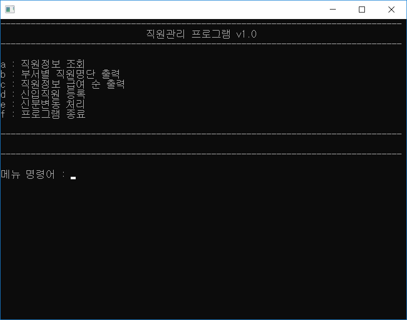

# Company Manager

[한국어](README.ko.md)

A C console program that registers full-time and part-time employees, looks them up by employee number, lists them by department or by pay, and processes changes in status. Employee data is saved to `CompanyDB.txt`. It uses a list that holds any struct given its element size and a dictionary with string keys, both written by hand in C, and its structs carry function pointers so they can be used like objects. It is a school assignment.

<p>
  
</p>


## How to use

Download from Releases and run it. Type a command after `메뉴 명령어 :` and press Enter. When a screen finishes its task, `메뉴 명령어 :` appears again, and typing `back` there returns to the main menu. The program's text is in Korean.

| Command | Action |
|---|---|
| `a` | Look up an employee by employee number |
| `b` | Choose a department and list its full-time employees |
| `c` | List full-time employees by position and salary step, highest first, and part-time employees by hourly pay, highest first |
| `d` | Register a new employee |
| `e` | Find an employee by number and enter the memo, department, position and salary step again |
| `f` | Quit |

An employee number has three characters: `R` for full-time or `A` for part-time, followed by a two-digit number from 01 to 99 (`R01`). Registering a new employee asks for the following in turn.

| Field | Input |
|---|---|
| Name | 1 to 10 bytes (five Korean characters) |
| Gender | `M` male, `F` female |
| Status memo | `Y` to type a memo, `N` to get a vacation day count instead |
| Department (full-time) | `A` Accounting, `B` Business, `C` Marketing, `D` Planning, `E` Public Relations |
| Position (full-time) | `0` CEO, `1` General Manager, `2` Deputy General Manager, `3` Manager, `4` Assistant Manager, `5` Staff |
| Salary step (full-time) | `A` for step 6 through `F` for step 1 |
| Hours worked, hourly pay (part-time) | An integer of 0 or more |

The vacation day count set at registration is 10 minus the position number for full-time employees (10 days for the CEO, 5 for staff) and 1 day for part-time employees. A new employee is appended to the end of `CompanyDB.txt`, and the whole file is rewritten after a status change. The file is read into the list when the program starts.


## How it works

**The list works by element size.** `List` holds a `void *` buffer and an element size, and adding an element copies it in whole with `memcpy`. The initial capacity is 2, and when the buffer fills up, the list allocates a new one twice the size and moves the contents over. The employee list is created with `NewList(sizeof(Employee))`, and the key-value pair list inside the dictionary with `NewList(sizeof(KeyValuePair))`.

```c
memcpy((byte *)(list->Item) + (list->Count * list->ItemSize), value, list->ItemSize);
++(list->Count);
```

**The dictionary sits on top of the list.** `Dictionary` puts `KeyValuePair` entries, each holding a `String` key and a copy of the value, into a list and finds a key by comparing from the start with `strcmp`. A key that already exists is not added again.

**Structs carry function pointers to act like objects.** Constructor functions such as `NewList`, `NewDictionary`, `NewMenu` and `NewCompany` allocate a struct and connect implementation functions such as `_ListAdd` to its fields. Calls pass the object itself as the first argument, as in `company->IndexOf(company, search)`, and `Dispose` frees the inner memory as well.

**The menu is a dictionary of commands.** Besides the screen text, `Menu` has a dictionary that maps command strings to callback function pointers. The main loop only looks up the typed command and calls the function it gets, and each callback clears the dictionary and registers the commands its screen accepts.

```c
void(*callback)(Menu *, Company *) = menu->Command(menu, command);
if (callback != NULL)
{
	system("cls");
	callback(menu, company);
}
```

**Employee data is a tagged union.** The department, position and salary step of full-time employees and the hours worked and hourly pay of part-time employees overlap in one union, and the first letter of the employee number decides which applies. The memo and vacation day count are also a union, told apart by a `TypeTag` value (`HAS_STRING`, `HAS_INT`). When the file is written or read, the memo tag and the first letter of the employee number also decide the layout of each line.


## Files

| Path | Content |
|---|---|
| `source/Company Manager.sln` | Visual Studio 2015 solution |
| `source/Company Manager/Main.c` | Main loop, per-screen callbacks, field input |
| `source/Company Manager/List.c` | Dynamic array handled by element size |
| `source/Company Manager/Dictionary.c` | Dictionary with string keys |
| `source/Company Manager/Menu.c` | Screen text and command dictionary |
| `source/Company Manager/Company.c` | Employee list, saving and loading the file |
| `source/Company Manager/Employee.c` | Employee output, names of departments, positions and salary steps |
| `source/Company Manager/InputExt.c` | Input functions that ask again until the check passes |
| `source/Company Manager/StringExt.c` | The `String` struct and digit, uppercase and lowercase checks |
| `source/Company Manager/TypeTag.h`, `source/Company Manager/Byte.h` | Union tags and the `byte` type |
| `docs/screenshots/` | Screenshots |
| Releases | Executable |


## License

zlib. See [LICENSE](LICENSE).
